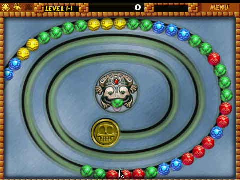

# pcapload

A standalone Windows loader for **PopCap "web plugin" games** — the ones that
used to run inside a browser page via the NPAPI plugin (`nppopcaploader.dll`,
e.g. the Zuma demo on the old popcap.com site).

`pcapload.exe` provides everything the browser plugin used to provide:

* a real window and a message pump fed to the game through `SexyProcessMsg`
* one `SexyUpdateState` frame per tick (~100 fps, like the plugin's timer)
* the host hooks the game DLL resolves by name:
  `getparam`, `setdrawparams`, `drawtodc`, `notify`, `getdllhandle`, `urlnavigate`
* embed-tag params (`levellimit`, `ShowUpsell`, ...) served through `getparam`
* a loading screen (progress bar) drawn into the game's DC via `drawtodc`
* automatic extraction of the original `.cab` installers via `cabinet.dll`
  (the same API the original loader used)

Nothing about a specific game is hardcoded — games are described by small
`.json` files in the `games` folder.



## No game data is included

This repository contains **only the loader**. The `.cab` installers, game
DLLs, artwork, sounds and level data are PopCap/EA copyrighted material and
are deliberately not distributed here. Supply them from a copy you already
own, then point a game description at them (see below).

## Status

| | |
|---|---|
| Build | 32-bit MSVC, CI on `windows-latest` |
| Tested | Zuma: boot, rendering, input. Bejeweled 2: boot/loading. |
| Configs | 12 game descriptions in `games/` (others untested, reports welcome) |
| Hosts | Windows (x86); Linux/macOS via Wine 11 (see [RUNNING-LINUX.md](RUNNING-LINUX.md)) |

The loader is a 32-bit PE because the game DLLs are 32-bit. A 64-bit build
cannot load them.

## Usage

```
pcapload.exe                 launcher (lists games, if there are several)
pcapload.exe zuma            run the game named "zuma"
pcapload.exe path\game.json  run a specific game description
```

Diagnostics: set the environment variable `PCAPLOAD_LOG=1` to write a trace
log to `pcapload.log` next to the exe.
`pcapload.exe --probe <game> [ms]` runs a game hidden for a few milliseconds
(used for smoke testing; never shows message boxes).

## Adding a game

Drop a `.json` file into `games/` next to `pcapload.exe`:

```json
{
    "name": "zuma",
    "displayName": "Zuma (Official Web Demo)",
    "dll": "Zuma/content/www.popcap.com/Zuma/Plugin/zuma_1_4/Zuma.dll",
    "cab": "Zuma/content/www.popcap.com/Zuma/Plugin/zuma_1_4.cab",
    "params": {
        "gamename": "zuma",
        "partnername": "PopCap",
        "displayname": "Zuma",
        "levellimit": "16",
        "upsellurl": "",
        "ShowUpsell": "false"
    }
}
```

* `name` — short id used on the command line (defaults to the file name)
* `displayName` — window title / launcher entry
* `dll` — path to the game DLL (required). Relative paths are resolved
  against the `.json` file's directory.
* `cab` — optional. If the DLL is missing, the cab is extracted into the
  game directory first.
* `dir` — optional game base directory; defaults to the DLL's folder. The
  game loads `resources.xml`, `levels/levels.xml`, etc. relative to it.
* `params` — the values served to the game through the `getparam` hook.
  These mirror the attributes of the original `<embed>` tag on the web page
  (e.g. `levellimit=16` limits the web demo to 16 levels).
* `createHookRva` / `createHookReg` — optional, for games that request
  extras downloads from *inside* `SexyCreateGame` (e.g. Bookworm
  Adventures): RVA of the `call` to the game's internal init inside its
  `SexyCreateGame` export, and the register holding the game object there
  (BWA: `"0x25d01"` + `"esi"`). pcapload patches a trampoline over that call
  so it can push `pc_downloadresult` back into the game while it is still
  loading, instead of deadlocking.

### Portable save data

The plugin games keep their settings in the registry under
`HKCU\SOFTWARE\PopCap\...` (on C:). The game DLL's advapi32 imports are
IAT-patched, and everything under that prefix is redirected to plain files
under `savedata\<game>\registry\<key path>\<value name>` next to the exe
(each value file = 4-byte type + data). Keys outside that prefix (and real
handles the game holds) still go to the real registry. Delete a game's
folder under `savedata\` to reset it; move it to move the save data.
Games that save files instead (e.g. Zuma's `.dat` files) already write
inside their own game dir.

### Game dir drive mapping (long paths only)

Some games build absolute paths in a fixed ~120-byte stack buffer without
bounds checks (they were designed for short web-install paths like
`C:\Program Files\PopCap\...`), so long paths crash them (`0xC0000409` /GS
abort in BookwormAdventures.dll). Game dirs longer than ~100 characters are
therefore mapped to a **free drive letter** (like `subst`) for the duration
of the run and removed on exit; ordinary-length dirs are passed through
unchanged. Letters are claimed Z: downward; each running instance gets its
own letter, and mappings left behind by crashed runs are reclaimed
automatically on the next start (a lock file next to pcapload.exe tracks
which pid owns which letter). Note the letter is just a path alias:
Explorer shows it with the underlying volume's label and size, but only the
game folder is reachable through it.

## Building

Requires a 32-bit MSVC toolchain (VS 2013 or newer; the game DLLs are
32-bit, so the loader must be too):

```
build.bat
```

`build.bat` locates the toolchain via `vswhere.exe` (falls back to VS
2015/2013 paths), then runs `cl` and produces `pcapload.exe` (PE32, no
external dependencies beyond system DLLs). GitHub Actions builds the same
target on every push — see `.github/workflows/build.yml`.

## Technical notes

The interface was reverse engineered from `nppopcaploader.dll` and
`Zuma.dll`:

Game DLL exports (all `__cdecl`):

```c
void* SexyCreateGame(HWND hwnd, const char* gameDir, DWORD flags,
                     void* hostCtx,
                     void* (__stdcall *resolve)(void* ctx, const char* name));
void  SexyDeleteGame(void* game);
void  SexyGetDimensions(void* game, int* w, int* h);
BOOL  SexyProcessMsg(void* game, UINT msg, WPARAM wp, LPARAM lp);
void  SexyReceiveNotification(void* game, const char* a, const char* b);
int   SexyUpdateState(void* game);      /* < 0 => shut down */
```

`SexyCreateGame` returns an opaque game object. `gameDir` is the directory
the game was extracted to *with a trailing slash* — the game concatenates
`"resources.xml"`, `"levels/levels.xml"`, `"upsellurl.txt"`, ... onto it.
The game resolves host hooks by name through `resolve` (an `__stdcall`
callback — every hook cleans its own stack, unlike the cdecl exports):

| hook             | signature (all `__stdcall`)                          |
|------------------|------------------------------------------------------|
| `getparam`       | `int f(void* ctx, const char* name, char* buf, int max)` |
| `setdrawparams`  | `void f(void* ctx, float progress, const char* s1, s2, s3)` |
| `drawtodc`       | `void f(void* ctx, HDC hdc)` — draw the loading art  |
| `notify`         | `void f(void* ctx, const char* name, const char* value)` |
| `getdllhandle`   | `void* f(void* ctx)`                                 |
| `urlnavigate`    | `void f(void* ctx, const char* url, const char* target)` |

`SexyProcessMsg` takes a fifth, hidden argument: an out-pointer where the
game writes the message result (Zuma.dll+0x1E293 does `mov [arg],ebx`).

`SexyUpdateState` internally paces itself and renders with GDI into the
window; `SexyGetDimensions` reports the native size (480x360 for the Zuma
demo). A negative `SexyUpdateState` return means the game wants to exit.

## Source layout

```
src/main.c      host side: window, pump, hooks, launcher, game json loading
src/json.c      small JSON parser
src/cab.c       .cab extraction via cabinet.dll (FDI)
src/registry.c  portable registry redirection (savedata/)
src/*.h
games/          game descriptions (12 configs included, no game data)
tools/          dev helpers (window screenshot/click, import dump)
docs/           README assets
```

## License and authorship

MIT — see [LICENSE](LICENSE). The project was developed with substantial AI
assistance; copyright is claimed only in the human-authored contributions
(design, reverse engineering, testing, documentation, selection and
arrangement) — details in [NOTICE.md](NOTICE.md). No PopCap/EA code or assets
are included. Game names are trademarks of their respective owners; this
project is unofficial and not affiliated with PopCap Games or Electronic Arts.
